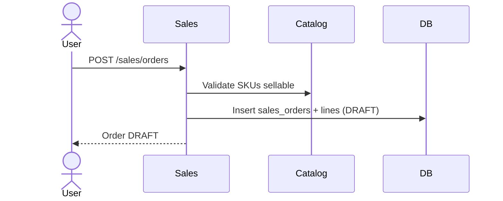
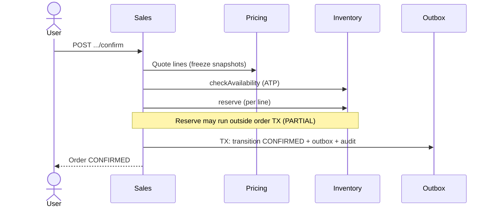
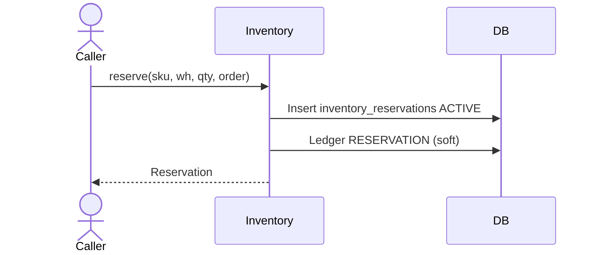
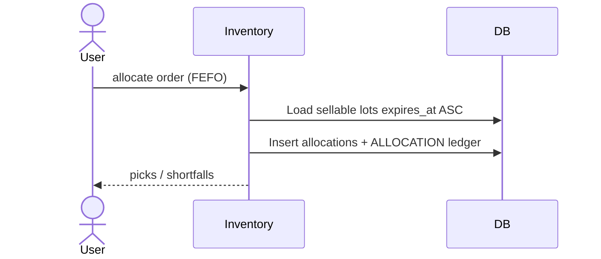
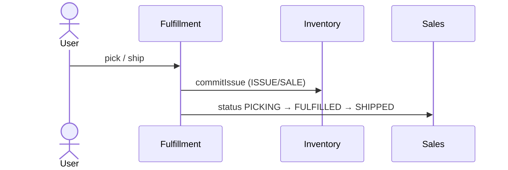
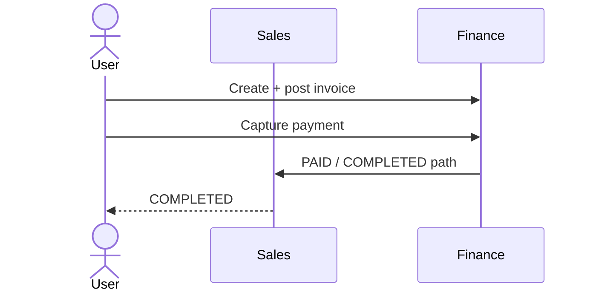
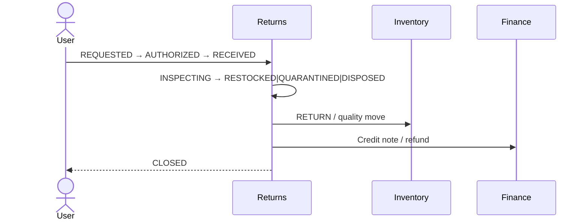
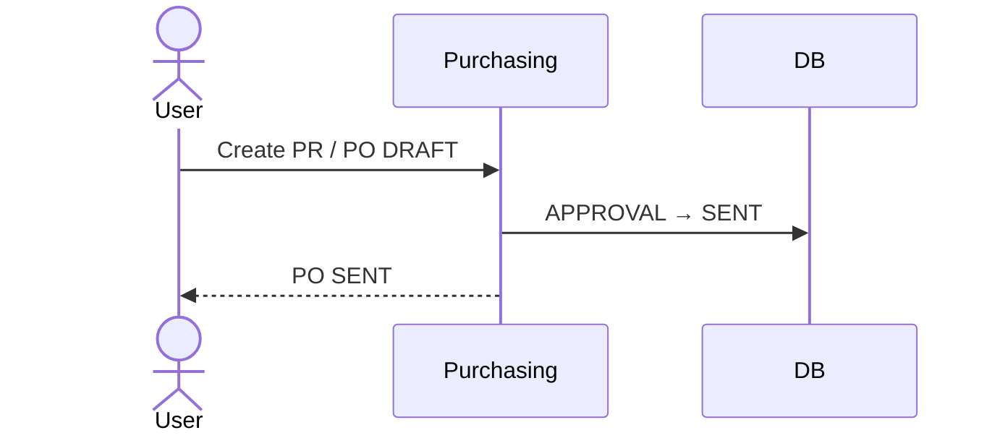
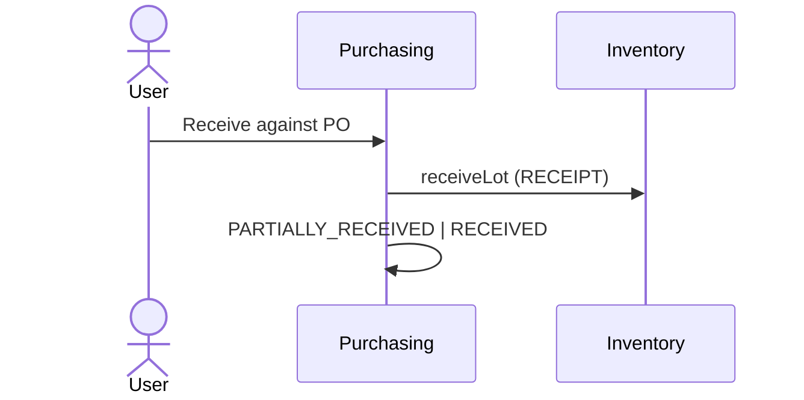
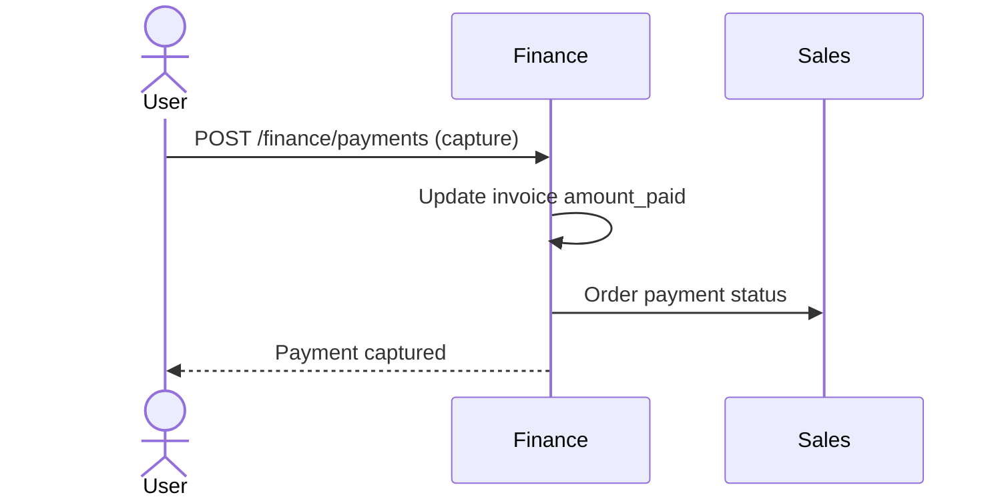

# Commercial Sequences

Mermaid sequence diagrams for primary commercial flows.

## Create Order

## Confirm Order

## Reserve

## Allocate FEFO

## Fulfill

## Complete Sale

## Return

## Create PO

## Receive Goods

## Process Payment

