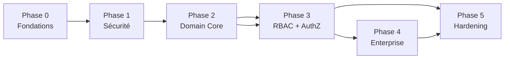
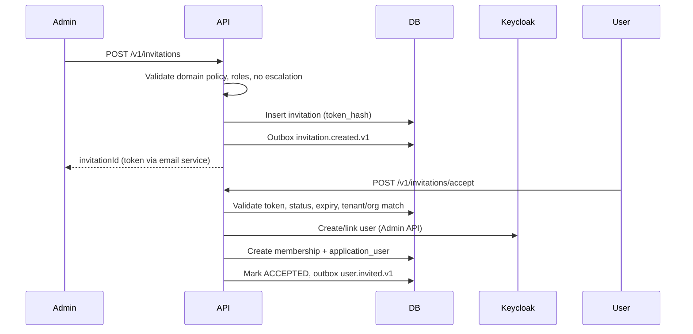

# Plan d'implémentation avancé — Identity & Tenant Management Core

**Version:** 1.0  
**Date:** 2026-09-01  
**Baseline:** Audit `IDENTITY-AUDIT-REPORT.md` (verdict NOT READY, P0=12)  
**Objectif:** Production-ready enterprise identity core en 4 phases (~16–24 semaines)

---

## 1. Principes directeurs

| Principe | Règle d'implémentation |
|----------|----------------------|
| Keycloak = IdP | Aucun credential, session, MFA stocké en PostgreSQL applicatif |
| `sub` = identité stable | `userId` applicatif = `claims.sub`, jamais email/username |
| Tenant depuis JWT | `tenant_id` uniquement depuis token validé |
| Org validée serveur | Membership DB vérifié avant toute opération org-scoped |
| Domain purity | `core/domain` sans NestJS, pg, Keycloak, RabbitMQ |
| Ports & adapters | Toute I/O via ports dans `core/domain/ports/` |
| Outbox obligatoire | Mutations lifecycle → event transactionnel |
| Idempotency | `Idempotency-Key` sur toutes mutations sensibles |
| Anti-énumération | Accès non autorisé → `FORBIDDEN` générique, pas `NOT_FOUND` ciblé |
| DB placement | Control plane = registry/metadata global ; tenant DB = prefs/settings tenant-scoped |

---

## 2. Architecture cible

### 2.1 Structure modules

```
src/
├── core/
│   ├── domain/
│   │   ├── tenant/           # + lifecycle transitions, profile
│   │   ├── organization/     # + lifecycle, settings
│   │   ├── user/             # NEW — application user profile
│   │   ├── membership/       # NEW — org membership + roles
│   │   ├── invitation/       # NEW
│   │   ├── role/             # NEW — role + permission catalog
│   │   ├── authorization/    # NEW — policy types
│   │   ├── configuration/    # NEW — settings schema
│   │   ├── security/         # NEW — MFA policy, access policy types
│   │   ├── delegation/       # NEW — phase 4
│   │   ├── audit/
│   │   └── events/           # catalog complet
│   └── application/
│       ├── tenant/           # use cases
│       ├── organization/
│       ├── user/
│       ├── membership/
│       ├── invitation/
│       ├── authorization/
│       ├── configuration/
│       ├── security/
│       └── reconciliation/   # Keycloak sync
├── shared/
│   ├── auth/                 # + context resolver, step-up
│   ├── keycloak/             # NEW — Admin API client
│   ├── authorization/        # NEW — PolicyEvaluator impl
│   ├── configuration/      # + ConfigurationResolver
│   └── database/             # + nouveaux repositories
└── modules/
    ├── platform/             # context, health (existant)
    ├── tenants/              # NEW — /v1/tenants (platform-admin)
    ├── organizations/        # NEW — /v1/organizations
    ├── users/                # NEW — /v1/users
    ├── memberships/          # NEW — /v1/memberships
    ├── invitations/          # NEW — /v1/invitations
    ├── roles/                # NEW — /v1/roles
    ├── settings/             # NEW — /v1/settings
    ├── security/             # NEW — /v1/security
    └── sessions/             # NEW — /v1/sessions (KC orchestration)
```

### 2.2 Flux de contexte (cible)

```
JWT (Keycloak)
  → JwtValidationService.validateToken()
  → UserPreferencesResolver.getActiveOrganization()  [tenant DB]
  → TenantContext.set({ subjectId, tenantId, organizationId, roles, permissions })
  → TenantGuard (registry + membership)
  → OrganizationGuard (si @RequireOrganization ou org présente)
  → AuthorizationService.evaluate(action, resource, context)  [remplace PermissionGuard simple]
  → Handler
  → AuditWriter + Outbox (si mutation)
```

### 2.3 Placement données

| Donnée | Store | Justification |
|--------|-------|---------------|
| tenants, organizations | Control plane | Registry global, résolution cross-service |
| user_tenant_memberships | Control plane | Gate d'entrée tenant |
| user_organization_memberships + roles | Control plane | Autorisation org, queries membership |
| roles, permissions (catalog) | Control plane | RBAC tenant-scoped via tenant_id |
| invitations | Control plane | Orchestration onboarding |
| audit_logs | Control plane | Centralisé, query admin |
| idempotency_keys | Control plane | Existant |
| user_preferences | Tenant DB | Co-localisé avec données métier tenant |
| tenant_settings, org_settings | Tenant DB | Overrides tenant-scoped |
| user_settings | Tenant DB | Préférences utilisateur |
| outbox_events | Tenant DB | Transactional outbox existant |
| application_users (profile) | Tenant DB | Profil applicatif par tenant |

---

## 3. Phases et dépendances



| Phase | Durée | Dépend de | Livrable clé |
|-------|-------|-----------|--------------|
| 0 — Fondations | 1–2 sem | — | `core/application`, conventions, CI gates |
| 1 — Sécurité | 2–3 sem | Phase 0 | P0 sécurité résolus, tests §86 base |
| 2 — Domain Core | 4–6 sem | Phase 1 | User, Membership, Tenant/Org APIs |
| 3 — RBAC + AuthZ | 4–5 sem | Phase 2 | AuthorizationService, roles, invitations |
| 4 — Enterprise | 4–8 sem | Phase 3 | KC sync, config engine, sessions/MFA |
| 5 — Hardening | 2–3 sem | Phase 4 | Perf, docs, score ≥4/5 |

---

## 4. Phase 0 — Fondations (1–2 semaines)

### 4.1 Objectifs
- Créer la couche `core/application/` vide mais structurée
- Définir conventions use case (input/output DTOs domain-pure)
- Étendre CI pour architecture tests identity

### 4.2 Tâches

| ID | Tâche | Fichiers | DoD |
|----|-------|----------|-----|
| 0.1 | Créer structure `core/application/` | `src/core/application/index.ts`, README interne | Import domain-only validé |
| 0.2 | Base use case abstractions | `core/application/common/use-case.ts`, `Result` type | Pattern documenté |
| 0.3 | Étendre architecture test | `test/architecture/domain-purity.spec.ts` | Interdit domain→application imports circulaires |
| 0.4 | Error model anti-énumération design | `core/domain/errors/access-denied.ts` | Spec des codes erreur |
| 0.5 | Event catalog registry | `core/domain/events/event-catalog.ts` | Liste types + versions |

### 4.3 Gate Phase 0
- [ ] `pnpm test:arch` green
- [ ] Structure modules créée (empty modules NestJS)
- [ ] ADR: placement données (control vs tenant DB)

---

## 5. Phase 1 — Sécurité & hardening (2–3 semaines)

**Priorité:** Résoudre P0-04, P0-06, P0-09, P0-10, P0-11

### 5.1 Correctifs immédiats

| ID | Changement | Fichier | Detail |
|----|------------|---------|--------|
| 1.1 | `userId = sub` | `jwt-validation.service.ts` | `preferred_username` → attribut display seulement |
| 1.2 | Preferences read on auth | `auth.guard.ts`, `user-preferences.port.ts` | `getActiveOrganization(userId)` ; valider membership avant override JWT |
| 1.3 | Anti-énumération | `global-exception.filter.ts`, guards | Unauthorized resource → `FORBIDDEN` + message générique |
| 1.4 | Tenant ARCHIVED | `tenant.entity.ts`, migration 004 | Ajouter `ARCHIVED` ; garder `DELETED` pour soft-delete final |
| 1.5 | Lifecycle transitions tenant | `tenant-lifecycle.ts` | `canTransition(from, to)` avec règles explicites |

```typescript
// core/domain/tenant/tenant-lifecycle.ts (cible)
const ALLOWED: Record<TenantStatus, TenantStatus[]> = {
  PROVISIONING: ['ACTIVE'],
  ACTIVE: ['SUSPENDED', 'READ_ONLY', 'DEACTIVATING'],
  SUSPENDED: ['ACTIVE'],
  READ_ONLY: ['ACTIVE', 'DEACTIVATING'],
  DEACTIVATING: ['ARCHIVED'],
  ARCHIVED: ['DELETED'],
  DELETED: [],
};
```

### 5.2 Authorization pipeline (intermédiaire)

| ID | Tâche | Detail |
|----|-------|--------|
| 1.6 | `@RequirePermissions` sur routes existantes | `platform.controller.ts` : `platform:read`, `platform:organizations:read` |
| 1.7 | Tests PermissionGuard | `permission.guard.spec.ts` |
| 1.8 | Tests OrganizationGuard, AuthGuard | Specs dédiés |

### 5.3 Suite tests sécurité

Créer `test/security/` :

| Test file | Scénarios §86 |
|-----------|---------------|
| `cross-tenant.spec.ts` | User A → Tenant B DENIED |
| `cross-organization.spec.ts` | Switch org non-membre DENIED |
| `enumeration.spec.ts` | Pas de leak existence |
| `jwt-attacks.spec.ts` | Wrong issuer/audience/expired |
| `fake-context.spec.ts` | Body/header tenantId/orgId ignorés |

### 5.4 Gate Phase 1
- [ ] P0-04, P0-06, P0-09, P0-10, P0-11 résolus
- [ ] `test/security/*` green en E2E
- [ ] Aucune route publique non-`@Public` sans permission explicite ou justification

---

## 6. Phase 2 — Domain Core (4–6 semaines)

### 6.1 Migrations control plane

**`migrations/control-plane/004_tenant_profile.sql`**
```sql
ALTER TABLE tenants ADD COLUMN IF NOT EXISTS legal_name VARCHAR(255);
ALTER TABLE tenants ADD COLUMN IF NOT EXISTS display_name VARCHAR(255);
ALTER TABLE tenants ADD COLUMN IF NOT EXISTS description TEXT;
ALTER TABLE tenants ADD COLUMN IF NOT EXISTS logo_url TEXT;
ALTER TABLE tenants ADD COLUMN IF NOT EXISTS country VARCHAR(2);
ALTER TABLE tenants ADD COLUMN IF NOT EXISTS timezone VARCHAR(50) DEFAULT 'UTC';
ALTER TABLE tenants ADD COLUMN IF NOT EXISTS locale VARCHAR(10) DEFAULT 'en';
ALTER TABLE tenants ADD COLUMN IF NOT EXISTS default_currency VARCHAR(3) DEFAULT 'EUR';
ALTER TABLE tenants ADD COLUMN IF NOT EXISTS default_language VARCHAR(10) DEFAULT 'en';
ALTER TABLE tenants ADD COLUMN IF NOT EXISTS date_format VARCHAR(20) DEFAULT 'YYYY-MM-DD';
ALTER TABLE tenants ADD COLUMN IF NOT EXISTS number_format VARCHAR(20) DEFAULT '1,234.56';
ALTER TABLE tenants ADD COLUMN IF NOT EXISTS plan_reference VARCHAR(100);
ALTER TABLE tenants DROP CONSTRAINT IF EXISTS tenants_status_check;
ALTER TABLE tenants ADD CONSTRAINT tenants_status_check
  CHECK (status IN ('PROVISIONING','ACTIVE','SUSPENDED','READ_ONLY','DEACTIVATING','ARCHIVED','DELETED'));
```

**`migrations/control-plane/005_membership_roles.sql`**
```sql
ALTER TABLE user_organization_memberships
  ADD COLUMN status VARCHAR(50) NOT NULL DEFAULT 'ACTIVE'
    CHECK (status IN ('ACTIVE','SUSPENDED','REVOKED')),
  ADD COLUMN roles JSONB NOT NULL DEFAULT '[]',
  ADD COLUMN permissions JSONB NOT NULL DEFAULT '[]',
  ADD COLUMN joined_at TIMESTAMPTZ NOT NULL DEFAULT NOW(),
  ADD COLUMN expires_at TIMESTAMPTZ,
  ADD COLUMN updated_at TIMESTAMPTZ NOT NULL DEFAULT NOW();

ALTER TABLE organizations
  ADD COLUMN description TEXT,
  ADD COLUMN timezone VARCHAR(50),
  ADD COLUMN locale VARCHAR(10),
  ADD COLUMN address JSONB DEFAULT '{}',
  ADD COLUMN contact JSONB DEFAULT '{}',
  ADD COLUMN metadata JSONB DEFAULT '{}';
```

**`migrations/control-plane/006_application_users.sql`**
```sql
CREATE TABLE application_users (
  id UUID PRIMARY KEY DEFAULT gen_random_uuid(),
  identity_id VARCHAR(255) NOT NULL,  -- Keycloak sub
  tenant_id UUID NOT NULL REFERENCES tenants(id),
  status VARCHAR(50) NOT NULL DEFAULT 'PENDING_ACTIVATION'
    CHECK (status IN ('INVITED','PENDING_ACTIVATION','ACTIVE','SUSPENDED','LOCKED','DISABLED','DELETED')),
  profile JSONB NOT NULL DEFAULT '{}',
  security_metadata JSONB NOT NULL DEFAULT '{}',
  last_seen_at TIMESTAMPTZ,
  created_at TIMESTAMPTZ NOT NULL DEFAULT NOW(),
  updated_at TIMESTAMPTZ NOT NULL DEFAULT NOW(),
  UNIQUE (tenant_id, identity_id)
);
CREATE INDEX idx_app_users_tenant ON application_users(tenant_id);
CREATE INDEX idx_app_users_identity ON application_users(identity_id);
```

### 6.2 Migrations tenant DB

**`migrations/tenant/003_user_profile_settings.sql`**
```sql
ALTER TABLE user_preferences ADD COLUMN IF NOT EXISTS settings JSONB NOT NULL DEFAULT '{}';

CREATE TABLE IF NOT EXISTS tenant_settings (
  namespace VARCHAR(100) NOT NULL,
  key VARCHAR(255) NOT NULL,
  value JSONB NOT NULL,
  sensitivity VARCHAR(20) NOT NULL DEFAULT 'normal',
  updated_at TIMESTAMPTZ NOT NULL DEFAULT NOW(),
  PRIMARY KEY (namespace, key)
);

CREATE TABLE IF NOT EXISTS organization_settings (
  organization_id UUID NOT NULL,
  namespace VARCHAR(100) NOT NULL,
  key VARCHAR(255) NOT NULL,
  value JSONB NOT NULL,
  updated_at TIMESTAMPTZ NOT NULL DEFAULT NOW(),
  PRIMARY KEY (organization_id, namespace, key)
);
```

### 6.3 Domain entities (nouveaux)

| Entity | Fichier | États lifecycle |
|--------|---------|-----------------|
| `ApplicationUser` | `core/domain/user/application-user.entity.ts` | INVITED → PENDING → ACTIVE → ... |
| `OrganizationMembership` | `core/domain/membership/organization-membership.entity.ts` | ACTIVE, SUSPENDED, REVOKED |
| `TenantProfile` | `core/domain/tenant/tenant-profile.ts` | Extension Tenant |
| `OrganizationLifecycle` | `core/domain/organization/organization-lifecycle.ts` | ACTIVE ↔ SUSPENDED → ARCHIVED |

### 6.4 Ports (nouveaux)

| Port | Méthodes clés |
|------|---------------|
| `ApplicationUserRepositoryPort` | `findByIdentity`, `findById`, `create`, `updateStatus` |
| `MembershipRepositoryPort` | `findByUser`, `findByOrg`, `create`, `revoke`, `updateRoles` |
| `TenantAdminPort` | `create`, `update`, `transitionStatus` (extends registry) |
| `OrganizationAdminPort` | `create`, `update`, `transitionStatus` |

### 6.5 Use cases

| Use case | Module | Permissions requises |
|----------|--------|---------------------|
| `GetTenantProfile` | tenant | `tenant:read` |
| `UpdateTenantProfile` | tenant | `tenant:update` |
| `TransitionTenantStatus` | tenant | `tenant:update` + lifecycle rules |
| `CreateOrganization` | organization | `organizations:create` |
| `UpdateOrganization` | organization | `organizations:update` |
| `SuspendOrganization` | organization | `organizations:suspend` |
| `GetUserProfile` | user | `users:read` |
| `UpdateUserProfile` | user | `users:update` (self ou admin) |
| `ListOrganizationMembers` | membership | `memberships:read` |
| `GrantMembership` | membership | `memberships:create` |
| `RevokeMembership` | membership | `memberships:revoke` |
| `UpdateMembershipRoles` | membership | `memberships:update` |

### 6.6 APIs REST

| Route | Controller |
|-------|------------|
| `GET/PATCH /v1/tenants/:tenantId` | `TenantsController` (tenant-admin) |
| `POST /v1/tenants/:tenantId/status` | Transition lifecycle |
| `GET/POST /v1/organizations` | `OrganizationsController` |
| `GET/PATCH /v1/organizations/:id` | |
| `POST /v1/organizations/:id/status` | |
| `GET/PATCH /v1/users/me` | `UsersController` |
| `GET /v1/users/:id` | Admin |
| `GET/POST/DELETE /v1/memberships` | `MembershipsController` |
| `PATCH /v1/memberships/:id` | Roles update |

Toutes routes : `@RequirePermissions`, `@AuditAction` sur mutations, `Idempotency-Key` sur POST/PATCH.

### 6.7 Events (nouveaux)

| Event | Trigger |
|-------|---------|
| `tenant.created.v1` | Provision complete |
| `tenant.updated.v1` | Profile update |
| `tenant.status.changed.v1` | Lifecycle transition |
| `organization.created.v1` | Org create |
| `organization.updated.v1` | Org update |
| `organization.suspended.v1` | Suspend |
| `membership.created.v1` | Grant |
| `membership.revoked.v1` | Revoke |
| `membership.roles.updated.v1` | Role change |
| `user.activated.v1` | First login / activation |

### 6.8 Gate Phase 2
- [ ] Migrations appliquées control + tenant
- [ ] CRUD tenant/org/user/membership APIs fonctionnelles
- [ ] Events outbox pour chaque mutation lifecycle
- [ ] Integration tests PostgreSQL (Testcontainers)
- [ ] E2E cross-tenant sur nouvelles routes

---

## 7. Phase 3 — RBAC, Invitations, Authorization (4–5 semaines)

### 7.1 Migrations RBAC

**`migrations/control-plane/007_rbac_catalog.sql`**
```sql
CREATE TABLE permissions (
  id UUID PRIMARY KEY DEFAULT gen_random_uuid(),
  resource VARCHAR(100) NOT NULL,
  action VARCHAR(100) NOT NULL,
  description TEXT,
  UNIQUE (resource, action)
);

CREATE TABLE roles (
  id UUID PRIMARY KEY DEFAULT gen_random_uuid(),
  tenant_id UUID REFERENCES tenants(id),  -- NULL = platform role
  scope VARCHAR(20) NOT NULL CHECK (scope IN ('platform','tenant','organization')),
  name VARCHAR(100) NOT NULL,
  is_system BOOLEAN NOT NULL DEFAULT false,
  description TEXT,
  created_at TIMESTAMPTZ NOT NULL DEFAULT NOW(),
  UNIQUE (tenant_id, scope, name)
);

CREATE TABLE role_permissions (
  role_id UUID NOT NULL REFERENCES roles(id) ON DELETE CASCADE,
  permission_id UUID NOT NULL REFERENCES permissions(id) ON DELETE CASCADE,
  PRIMARY KEY (role_id, permission_id)
);

CREATE TABLE tenant_owners (
  tenant_id UUID PRIMARY KEY REFERENCES tenants(id),
  user_id VARCHAR(255) NOT NULL,
  identity_id VARCHAR(255) NOT NULL,
  assigned_at TIMESTAMPTZ NOT NULL DEFAULT NOW()
);
```

**`migrations/control-plane/008_invitations.sql`**
```sql
CREATE TABLE invitations (
  id UUID PRIMARY KEY DEFAULT gen_random_uuid(),
  tenant_id UUID NOT NULL REFERENCES tenants(id),
  organization_id UUID NOT NULL REFERENCES organizations(id),
  email VARCHAR(255) NOT NULL,
  invited_by VARCHAR(255) NOT NULL,
  roles JSONB NOT NULL DEFAULT '[]',
  permissions JSONB NOT NULL DEFAULT '[]',
  token_hash VARCHAR(64) NOT NULL UNIQUE,
  status VARCHAR(20) NOT NULL DEFAULT 'PENDING'
    CHECK (status IN ('PENDING','ACCEPTED','EXPIRED','REVOKED')),
  expires_at TIMESTAMPTZ NOT NULL,
  accepted_at TIMESTAMPTZ,
  created_at TIMESTAMPTZ NOT NULL DEFAULT NOW()
);
CREATE INDEX idx_invitations_tenant_email ON invitations(tenant_id, email);
```

### 7.2 AuthorizationService (remplace PermissionGuard simple)

```typescript
// core/domain/authorization/authorization-context.ts
interface AuthorizationContext {
  subjectId: string;
  tenantId: string;
  organizationId?: string;
  roles: readonly string[];
  permissions: readonly string[];
  membershipRoles?: readonly string[];
  membershipPermissions?: readonly string[];
}

// core/domain/authorization/policy-evaluator.port.ts
interface PolicyEvaluatorPort {
  evaluate(
    action: string,           // e.g. 'users:update'
    resource: ResourceRef,
    context: AuthorizationContext,
  ): Promise<AuthorizationDecision>;
}
```

**Résolution permissions (ordre):**
1. JWT permissions (Keycloak)
2. Membership permissions (DB)
3. Role expansion (DB catalog)
4. Deny par défaut

**Organization scope:** permission `users:update` en org A ≠ org B.

### 7.3 Invitation flow



**Sécurité invitations:**
- Token 32 bytes random → SHA-256 hash en DB
- Single-use, expiry enforced
- `organizationId` lié — pas de réutilisation cross-org
- Rate limit: 10 invitations/min/tenant

### 7.4 Last-admin & ownership

| Règle | Implémentation |
|-------|----------------|
| Last admin protection | `MembershipService.revoke()` → count admins ; si dernier → `FORBIDDEN` |
| Ownership transfer | `TransferTenantOwnership` use case : step-up token, audit, atomic swap `tenant_owners` |
| Break-glass | Phase 4 — `emergency_access_grants` table |

### 7.5 APIs Phase 3

| Route | Permission |
|-------|------------|
| `GET/POST /v1/roles` | `roles:read`, `roles:create` |
| `GET/POST /v1/permissions` | `permissions:read` |
| `POST /v1/roles/:id/permissions` | `roles:update` |
| `POST /v1/invitations` | `users:invite` |
| `POST /v1/invitations/accept` | Public + token |
| `POST /v1/invitations/:id/revoke` | `users:invite` |
| `POST /v1/tenants/:id/ownership/transfer` | `tenant:ownership:transfer` |

### 7.6 Seed permissions système

```text
tenant:read, tenant:update
organizations:read, organizations:create, organizations:update, organizations:suspend
users:read, users:invite, users:update, users:suspend
memberships:read, memberships:create, memberships:update, memberships:revoke
roles:read, roles:create, roles:update
permissions:read
settings:read, settings:update
security:read, security:update
tenant:ownership:transfer
```

Roles système (non modifiables):
- `tenant-owner`, `tenant-administrator`, `organization-administrator`, `manager`, `viewer`

### 7.7 Gate Phase 3
- [ ] AuthorizationService sur toutes routes
- [ ] Invitations E2E (create → accept → membership)
- [ ] Last-admin test concurrent (2 threads revoke)
- [ ] Ownership transfer avec step-up mock
- [ ] P0-01, P0-02, P0-03, P0-12 résolus

---

## 8. Phase 4 — Enterprise (4–8 semaines)

### 8.1 Keycloak Admin API client

**`shared/keycloak/keycloak-admin.client.ts`**

| Opération | Usage |
|-----------|-------|
| `createOrganization` | Org create sync |
| `updateOrganization` | Org update |
| `addUserToOrganization` | Membership grant |
| `removeUserFromOrganization` | Membership revoke |
| `createUser` | Invitation accept |
| `getUserSessions` | Session list |
| `revokeSession` | Logout device |
| `sendExecuteActionsEmail` | Password reset orchestration |

Config: `KEYCLOAK_ADMIN_URL`, `KEYCLOAK_ADMIN_CLIENT_ID`, credentials via `SecretProvider`.

### 8.2 Reconciliation service

**`core/application/reconciliation/reconcile-keycloak.use-case.ts`**

| Drift type | Action |
|------------|--------|
| KC org exists, app missing | Report + optional repair (create app org) |
| App org exists, KC missing | Report + optional repair (create KC org) |
| Membership mismatch | Report + repair with confirmation |
| User in KC not in app | Report |

Job schedulé : `ReconciliationJob` via `JobScheduler` (Redis lock).

API admin : `POST /v1/admin/reconciliation/run` + `GET /v1/admin/reconciliation/report`.

### 8.3 Configuration engine

```typescript
// core/domain/configuration/setting-definition.ts
interface SettingDefinition {
  key: string;
  namespace: string;
  type: 'string' | 'number' | 'boolean' | 'json';
  default: unknown;
  scope: 'platform' | 'tenant' | 'organization' | 'user';
  overrideable: boolean;
  sensitive: boolean;
  validation: ZodSchema;
}

// shared/configuration/configuration-resolver.service.ts
resolve<T>(key, context): T
// User override → Org override → Tenant setting → Platform default
```

Namespaces initiaux : `localization.*`, `security.*`, `ui.*`, `notifications.*`

Sensitive settings → `SecretProvider`, jamais en `tenant_settings` plain.

### 8.4 MFA & Session orchestration

| API | Backend |
|-----|---------|
| `GET /v1/security/mfa/status` | KC user credentials query |
| `GET /v1/sessions` | KC sessions list |
| `POST /v1/sessions/revoke` | KC session revoke + audit |
| `POST /v1/sessions/revoke-all` | KC logout all |
| `GET/PATCH /v1/security/policies` | Tenant MFA policy (stored tenant_settings) |

MFA policies : `optional`, `required`, `required_for_admins`, `required_for_sensitive_ops`

Step-up : claim `acr` ou `amr` dans JWT ; `@RequireStepUp()` decorator.

### 8.5 Feature flags abstraction

```typescript
// core/domain/feature-flag/feature-flag.port.ts
interface FeatureFlagServicePort {
  isEnabled(flag: string, context: FeatureContext): Promise<boolean>;
}
// Impl: tenant_settings namespace 'features.*' → future LaunchDarkly adapter
```

### 8.6 Delegation & break-glass (optionnel MVP+)

Tables :
- `delegations` (grantor, grantee, permissions, org, expires_at)
- `emergency_access_grants` (reason, operator, scope, expires_at, approved_by)

### 8.7 Gate Phase 4
- [ ] KC reconciliation job operational
- [ ] Configuration resolver avec tests override chain
- [ ] Session list/revoke via KC
- [ ] P0-05 résolu
- [ ] Documentation KEYCLOAK-INTEGRATION.md, AUTHORIZATION.md complètes

---

## 9. Phase 5 — Hardening & production (2–3 semaines)

### 9.1 Performance & concurrence

| Test | Outil | Cible |
|------|-------|-------|
| Ownership transfer race | vitest + parallel fetch | 1 seul succès |
| Last-admin concurrent revoke | idem | DENIED |
| Membership bulk 100 | load test k6 | < 500ms p95 |
| Tenant pool under 50 tenants | stress | No pool leak |

### 9.2 Observability identity

Métriques Prometheus (labels `tenant_id` agrégé, pas cardinalité excessive) :
```text
identity_login_failures_total
identity_permission_denied_total
identity_cross_tenant_attempts_total
identity_invitation_failures_total
identity_membership_changes_total
identity_reconciliation_drifts_total
```

### 9.3 Documentation (§84)

| Document | Contenu |
|----------|---------|
| `IDENTITY-ARCHITECTURE.md` | C4, flows |
| `TENANT-ARCHITECTURE.md` | Lifecycle, provisioning |
| `ORGANIZATION-ARCHITECTURE.md` | KC sync |
| `KEYCLOAK-INTEGRATION.md` | Claims, Admin API |
| `AUTHORIZATION.md` | RBAC + contextual |
| `SECURITY-POLICIES.md` | MFA, IP, domains |
| `PREFERENCES.md` | Resolution chain |
| `CONFIGURATION.md` | Settings engine |
| `MEMBERSHIPS.md` | Grant/revoke flows |
| `INVITATIONS.md` | Token security |
| `AUDIT.md` | Event catalog |

### 9.4 CI pipeline extensions

```yaml
# .github/workflows/ci.yml additions
- test:unit
- test:arch
- test:security      # test/security/*
- test:integration   # Testcontainers (opt-in label)
- test:e2e
```

### 9.5 Gate production (§85 + §87)

| Critère | Seuil |
|---------|-------|
| P0 findings | 0 |
| Score moyen §89 | ≥ 4.0 / 5 |
| §86 security tests | 100% green |
| Cross-tenant isolation | Démontré par tests |
| Documentation §84 | Complète |
| Load test | p95 API < 200ms (read), < 500ms (write) |

---

## 10. Matrice risques

| Risque | Probabilité | Impact | Mitigation |
|--------|-------------|--------|------------|
| Drift Keycloak ↔ app | Haute | Critique | Reconciliation job + create sync atomique |
| Race last-admin | Moyenne | Critique | Transaction + `SELECT FOR UPDATE` sur admin count |
| Token invitation leak | Faible | Critique | Hash only, short TTL, rate limit |
| Permission escalation via invite | Moyenne | Critique | Inviter ne peut assigner que ses permissions ⊆ |
| Cardinalité metrics tenant_id | Moyenne | Moyenne | Agrégation, pas label par tenant en prod |
| KC Admin API downtime | Moyenne | Haute | Circuit breaker, queue retry, degrade read-only |
| Migration control plane downtime | Faible | Haute | Backward-compatible migrations, blue/green |

---

## 11. Ordre d'implémentation fichier (sprint 1–2)

**Sprint 1 (sécurité):**
1. `tenant-lifecycle.ts` + tests
2. `jwt-validation.service.ts` fix userId
3. `user-preferences.port.ts` + read method
4. `auth.guard.ts` preference resolution
5. `global-exception.filter.ts` anti-enum
6. `permission.guard.spec.ts`, `organization.guard.spec.ts`
7. `test/security/*.spec.ts`

**Sprint 2 (user + membership domain):**
1. `application-user.entity.ts`
2. `organization-membership.entity.ts`
3. Ports + pg repositories
4. Migrations 004–006
5. `GrantMembershipUseCase`, `RevokeMembershipUseCase`
6. `MembershipsController`

**Sprint 3 (org + tenant APIs):**
1. `CreateOrganizationUseCase` + KC client stub
2. `OrganizationsController`
3. `TenantsController` (platform-admin guard)
4. Events + outbox wiring

**Sprint 4 (RBAC):**
1. Migration 007 + seed permissions
2. `PolicyEvaluator` implementation
3. `AuthorizationService` + guard replacement
4. `RolesController`

**Sprint 5 (invitations):**
1. Migration 008
2. `CreateInvitationUseCase`, `AcceptInvitationUseCase`
3. `InvitationsController`
4. E2E full onboarding flow

---

## 12. Definition of Done (global)

Chaque feature doit inclure :

- [ ] Domain entity + lifecycle rules (si applicable)
- [ ] Port interface dans `core/domain/ports/`
- [ ] Use case dans `core/application/`
- [ ] Repository adapter (pg)
- [ ] Controller + DTOs + validation Zod/class-validator
- [ ] `@RequirePermissions` + `@AuditAction` sur mutations
- [ ] Outbox event si mutation lifecycle
- [ ] Unit tests domain + use case
- [ ] Integration test repository (Testcontainers)
- [ ] E2E test happy path + denial path
- [ ] Security test si accès cross-tenant/org
- [ ] Migration up (backward compatible)
- [ ] Mise à jour doc pertinente

---

## 13. Estimation effort

| Phase | Dev (jours) | QA (jours) | Total |
|-------|-------------|------------|-------|
| 0 Fondations | 5–8 | 2 | 1–2 sem |
| 1 Sécurité | 10–15 | 5 | 2–3 sem |
| 2 Domain Core | 25–35 | 10 | 4–6 sem |
| 3 RBAC + Invitations | 20–30 | 10 | 4–5 sem |
| 4 Enterprise | 25–40 | 10 | 4–8 sem |
| 5 Hardening | 10–15 | 10 | 2–3 sem |
| **Total** | **85–133** | **37** | **16–24 sem** |

Équipe recommandée : 2 devs backend senior + 1 QA sécurité (part-time) + revue architecture hebdo.

---

## 14. Verdict cible post-implémentation

| Métrique | Actuel | Cible |
|----------|--------|-------|
| Verdict | NOT READY | PRODUCTION READY |
| P0 | 12 | 0 |
| Score §89 | 31% | ≥ 80% |
| APIs §54 | 3 endpoints | ~40 endpoints |
| Events | 1 | ≥ 15 |
| Security tests §86 | 4/15 | 15/15 |
| Docs §84 | 0/12 | 12/12 |
