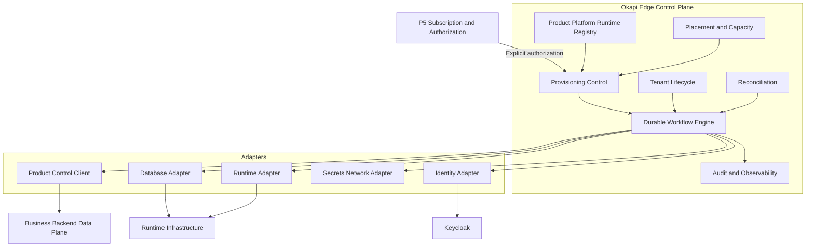

# P7.0.14 — Target Architecture Consolidation

**Date:** 2026-11-10  
**Physical shape:** Remain **modular monolith** in `saas-templates-backend` Edge module unless later ADR proves need to split.

---

## Logical components (validated against audit)

## Ownership boundaries (locked)

| Plane | Owns |
|-------|------|
| Edge CP | Registries, placement, workflow, evidence, technical lifecycle, product-tenant registry |
| P5 | Commercial auth, entitlements definition |
| P6 | Money |
| BB | Business orgs, establishments, users, roles, schema, AuthZ métier |
| Keycloak | Technical identity configuration prepared via contract |

## Non-goals

- Edge owning business memberships  
- P7 interpreting raw invoices for activation  
- Replacing Identity ERP tenant provisioner  
- Mandatory Kubernetes  

## Compatibility with existing code

- New packages under `modules/edge/domain/provisioning|workflow|…`  
- Replace Unavailable provisioning adapter with real P7 adapter at G1+  
- Keep Identity orchestrator untouched for ERP path  
