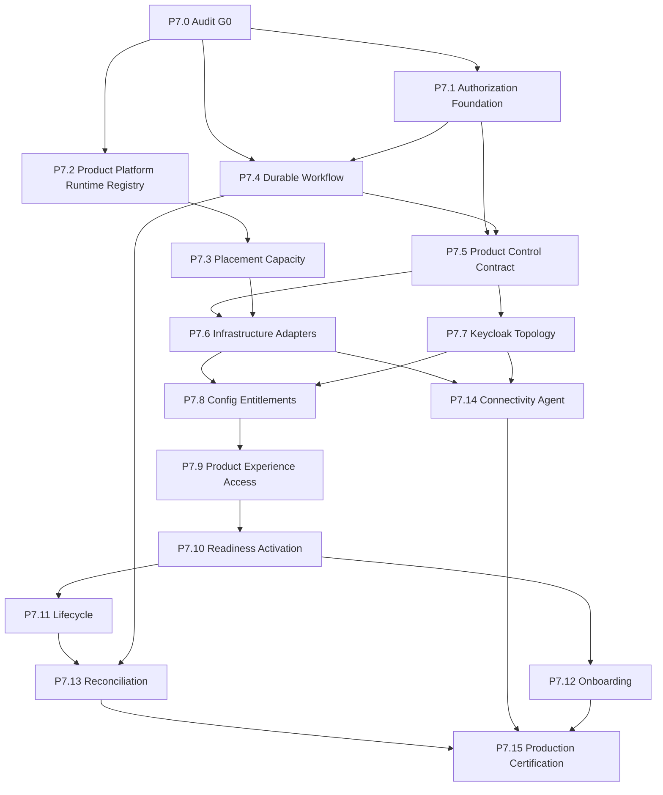

# P7.0.16 — Implementation Dependency Graph

**Date:** 2026-11-10  
**Audit adjustment:** No separate BB repo → Product Control mock/reference required before real BB certification. Live KC version VERIFY parallel to P7.1–P7.2 (does not block authorization foundation).

## Parallelism allowed

| Parallel track | Constraint |
|----------------|------------|
| P7.1 + P7.2 | After G0 |
| Live Keycloak version capture | ASAP; blocks claiming Mode A/B prod |
| FE requests UI | After P7.1 list/get API stable |
| ADR formal approval | Before mass P7.4–P7.7 build |

## Critical path (reference SaaS)

G0 → P7.1 → P7.4 → P7.5 → (P7.6 ∥ P7.7) → P7.8 → P7.9 → P7.10
