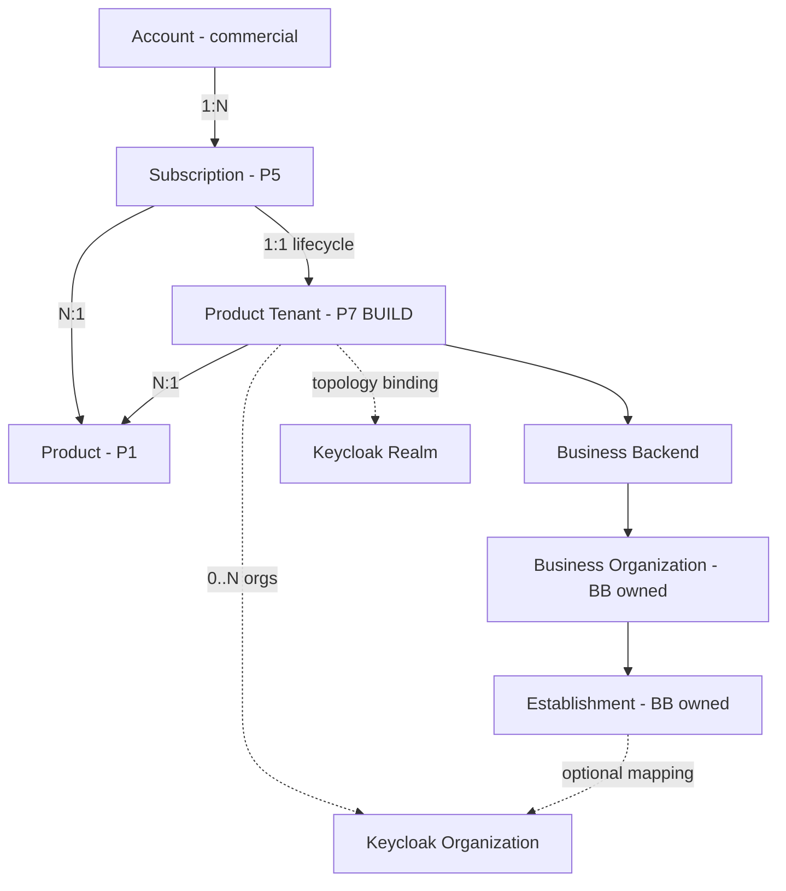

# P7.0.3 — Domain Relationship Diagram

**Date:** 2026-11-10  
**Status:** Target cardinality (validated against existing commercial model + gaps)



## Distinct from Identity ERP

```text
Identity Tenant (CP tenants table)
    └── KC Organization in realm "platform"
Edge Vertical
    └── keycloak_organization_id (workspace)
```

These are **not** Product Tenant.

## Observed gaps

| Relation | Code today |
|----------|------------|
| Subscription → Product | Yes (`edge_subscriptions`) |
| Subscription → Product Tenant | `tenant_ref` string on provisioning rows only |
| Product Tenant registry | Absent |
| Establishment → KC org | Absent in Edge |
