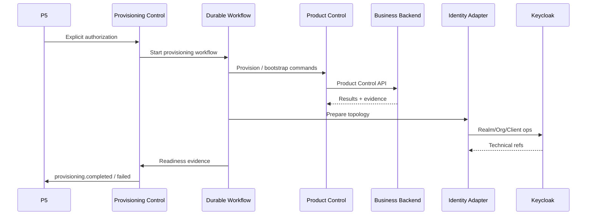
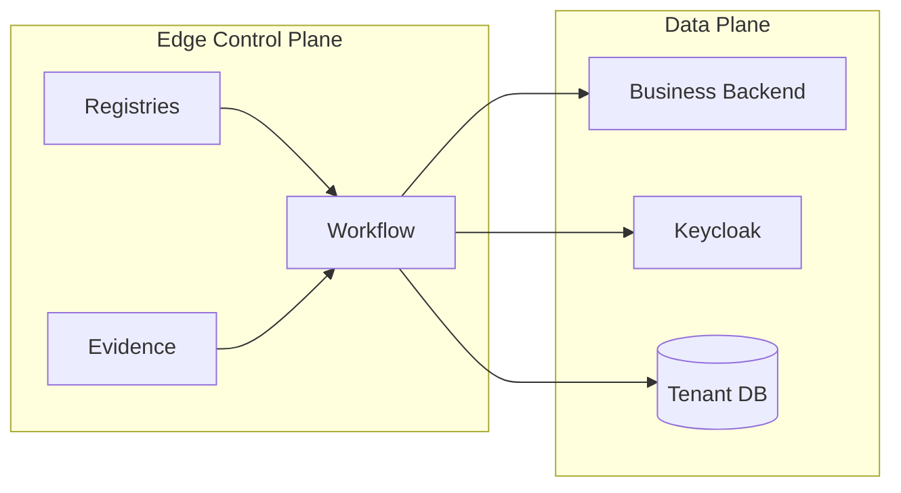

# P7.0.14 — Target Architecture Diagrams

**Date:** 2026-11-10  
**Physical:** Modular monolith (Nest Edge module) — not a microservice split prescription.

## Logical control flow

## Ownership swimlanes

