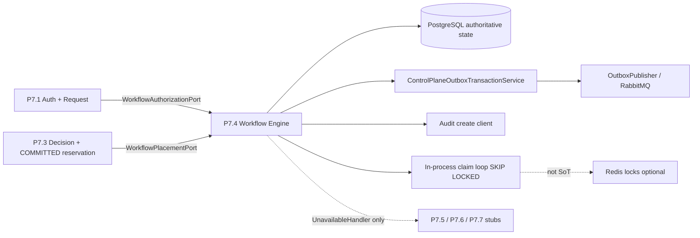

# P7.4 — Durable Workflow Engine — Inspection & Architecture

| Field | Value |
|-------|-------|
| **Status** | INSPECTION COMPLETE — design / architecture only (**no implementation**) |
| **Date** | 2026-11-10 |
| **Mandate** | P7.4 IMPLEMENTATION MANDATE — Durable Workflow & Saga Engine |
| **Depends on** | P7.1 (authorization foundation), P7.2 (registry), P7.3 (placement & capacity) |
| **Migration target** | `099_edge_p7_durable_workflow_engine.sql` |
| **Explicitly out of scope** | P7.5 live BB, P7.6 infra adapters, P7.7 Keycloak create, tenant ACTIVE, successful provision handlers |

---

## 0. Repository baseline (verified)

### Backend — `e:\whatif\saas-templates-backend`

| Check | Result |
|-------|--------|
| Branch | `feature/console` |
| HEAD | `52dfb9f01af6195ee314daed20ff498297f69662` |

```
52dfb9f docs(P7.3): record remote push 403 blocker in acceptance report.
e524e96 feat(P7.3): implement placement engine and concurrency-safe capacity management.
7f63ded fix(P7.2): remediate audit findings for TX atomicity, fail-closed compat, DTOs, and profile certification.
915e323 fix(P7.2): complete outbox version events, OpenAPI DTOs, tests, migrate proof
beb80b2 fix(P7.2): close registry gaps for version GET, product FK, release channel
```

### Frontend — `e:\whatif\saas-template-frontend`

| Check | Result |
|-------|--------|
| Branch | `feature/console` |
| HEAD | `fcc9ca991fd729aaccd3e23ef35d0440ec1a262c` |

```
fcc9ca9 feat(P7.3): add Placement and Capacity console screens.
4ea7732 test(P7.2): add Registry UI integration coverage beyond helper unit tests.
dbfe650 fix(P7.2): use canonical STABLE release channels in registry UI
2fb5805 feat(P7.2): Edge console Registry Management UI
abe9dbf P7.1 On progress
```

**Verdict:** both repos confirmed on `feature/console`. P7.3 is HEAD on both sides. Safe to design P7.4 on this baseline. **This document does not authorize or contain engine code.**

---

## 1. P7.1 authorization entities & ports (revalidate)

P7.4 must **revalidate** canonical P7.1 state before creating or advancing a provisioning-bound workflow. Events alone are never proof of authorization.

### 1.1 Tables / aggregates (migration `095`)

| Artifact | Path / name | Role for P7.4 |
|----------|-------------|----------------|
| Authorizations | `edge_provisioning_authorizations` | SoT for decision, verification, revocation, expiry |
| Requests | `edge_provisioning_requests` (+ history) | Durable request; must be `ACCEPTED` to start provision workflow |
| Revocation inbox | `edge_p7_authorization_revocation_inbox` | Idempotent revoke intake |

### 1.2 Domain vocabulary

**Path:** `src/modules/edge/domain/provisioning/provisioning.types.ts`

| Concept | Values P7.4 must honor |
|---------|------------------------|
| `ProvisioningAuthorizationStatus` | `ISSUED` \| `ACTIVE` \| `REVOKED` \| `EXPIRED` \| `SUPERSEDED` |
| `ProvisioningDecision` | `ALLOW` \| `DENY` |
| `RevocationStatus` | `NOT_REVOKED` \| `REVOKED` |
| `AuthorizationVerificationStatus` | `PENDING` \| `VERIFIED` \| `REJECTED` \| `REVOKED` \| `EXPIRED` |
| `ProvisioningRequestStatus` | `REQUESTED` \| `ACCEPTED` \| `REJECTED` \| `CANCELLED` \| `FAILED` |

Fail-closed gate before workflow create / protected step boundaries:

- request status = `ACCEPTED`
- decision = `ALLOW`
- verificationStatus = `VERIFIED`
- revocationStatus = `NOT_REVOKED`
- not expired (`expires_at` / not_before)
- authorization version matches the bound reference

### 1.3 Ports / verification (reuse — do not fork logic)

| Symbol / type | Path | P7.4 use |
|---------------|------|----------|
| `PROVISIONING_REPOSITORY_PORT` / `ProvisioningRepositoryPort` | `domain/provisioning/provisioning-repository.port.ts` | Load auth + request by id/version |
| `P5_AUTHORIZATION_STATUS_PORT` | `domain/provisioning/p5-authorization-status.port.ts` | Optional live status check when configured |
| `authorization-verification.ts` | domain helpers | Signature / audience / temporal verification rules |
| `monotonic-revocation.ts` | domain helpers | Monotonic revoke version |
| Revocation use-cases + inbox | `application/provisioning/*`, `pg-provisioning.repository.ts` | Mid-flight revoke → hold / safe policy |

**P7.4 typed façade (new):** `WorkflowAuthorizationPort` (§10) — thin adapter over the above; **must not** reimplement P7.1 verification inside the engine.

### 1.4 Precedent: PlacementAuthorizationViewPort

P7.3 already established the pattern:

- `PLACEMENT_AUTHORIZATION_VIEW_PORT` → `PlacementReadyAuthorizationView` only when gates pass; else `null` (fail-closed).
- Impl: `PgPlacementAuthorizationViewAdapter`.

P7.4 should mirror this with `WorkflowAuthorizationPort` (provisioning-ready view), not call placement’s port for non-placement concerns.

---

## 2. P7.3 placement decision / reservation validation hooks

Confirm (`ConfirmPlacementUseCase`) explicitly does **not** start P7.4. Workflow start must independently validate placement.

### 2.1 Preconditions for provisioning workflow start

| Check | Required evidence |
|-------|-------------------|
| Placement request | Exists; status compatible with confirmed placement (`PLACED` after confirm path) |
| Decision | `decisionStatus = PLACED`; version matches bound reference; not `EXPIRED` / `SUPERSEDED` / `CANCELLED` |
| Reservation | Linked via `capacityReservationId`; status = **`COMMITTED`** (not merely `HELD`) |
| Registry refs | `selectedPlatformId`, `selectedEnvironmentId`, `selectedProfileId`, `selectedTechnicalVersionId`, `selectedContractId` (+ version) present and still valid vs P7.2 reads |
| Expiry / supersede | `decision.expiresAt` not past; no newer superseding decision for the same request |
| Correlation | Align with P7.1 `correlationId` / provisioning request id |

### 2.2 Ports / records to consume

| Artifact | Path |
|----------|------|
| Types | `domain/placement/placement.types.ts` (`PlacementDecisionRecord`, `CapacityReservationStatus`, …) |
| Repository | `PLACEMENT_REPOSITORY_PORT` — `getDecision`, `getReservation`, `getRequest`, … |
| Events (observe only) | `p7.placement.decision.confirmed.v1`, `p7.capacity.reservation.committed.v1` — **revalidate DB**, do not trust event payload alone |
| Confirm boundary | `ConfirmPlacementUseCase` comment: *no P7.4 workflow side effects* |

**P7.4 typed façade (new):** `WorkflowPlacementPort` (§10) — validates decision + COMMITTED reservation + version; returns a fail-closed view or `null` / typed reject.

### 2.3 Capacity locking precedent (reuse pattern, not JobScheduler)

`reserveCapacityWithLock` already uses **`SELECT … FOR UPDATE`** inside shared TX. P7.4 step claiming should follow the same PostgreSQL-authoritative locking style (`FOR UPDATE SKIP LOCKED` for multi-worker claim).

---

## 3. Transactional primitives to reuse

### 3.1 Outbox — `ControlPlaneOutboxTransactionService`

| Item | Detail |
|------|--------|
| Path | `src/shared/messaging/control-plane-outbox-transaction.service.ts` |
| API | `runWithOutbox(tenantId, (client, enqueue) => …)` |
| P7 tenant sentinel | `EDGE_P7_OUTBOX_TENANT` (`domain/provisioning/provisioning.events.ts`) |
| Rule | **Reuse** — do not create a second outbox implementation |

Atomic block for workflow mutations (mandate §12): state + steps + attempts + checkpoints + human tasks + compensation + history + **audit** + **enqueue**.

### 3.2 Outbox publisher (existing)

| Item | Detail |
|------|--------|
| Class | `OutboxPublisher` (`src/shared/messaging/outbox.publisher.ts`) |
| Claim | CP store `fetchPending` uses **`FOR UPDATE SKIP LOCKED`** |
| Leader | Redis `SET NX` lock `platform:lock:outbox-publisher` |
| Broker | RabbitMQ publish after durable enqueue |

Outbox publisher = **event reliability**, not saga step execution.

### 3.3 Inbox

| Item | Detail |
|------|--------|
| Port | `INBOX_DEDUPLICATOR_PORT` / `InboxDeduplicatorPort` (`core/domain/ports/inbox.port.ts`) |
| Impl | `PgInboxDeduplicator` via `messaging.module.ts` |
| P7.1 specialty | `edge_p7_authorization_revocation_inbox` for revoke idempotency |

Workflow event consumers must be idempotent (at-least-once). Prefer shared inbox claim or domain-idempotency keys; do not assume exactly-once delivery.

### 3.4 Audit — `create(…, client?)`

| Item | Detail |
|------|--------|
| Port | `AUDIT_EVENT_REPOSITORY_PORT` / `AuditEventRepositoryPort` |
| Path | `domain/ports/audit-event-repository.port.ts` |
| Signature | `create(params, client?: unknown)` |
| Pattern | P7.2/P7.3 `requireAudit(audit, input, client)` inside `runWithOutbox` — failure rolls back TX |

P7.4 must pass `client` on every mandatory audit write.

### 3.5 Transaction manager

| Item | Detail |
|------|--------|
| Port | `CONTROL_PLANE_TRANSACTION_MANAGER_PORT` |
| Impl | `PgControlPlaneTransactionManager` |
| API | `runInTransaction(fn)` — wrapped by outbox service |

**Handler protocol (mandate):** claim/persist inside TX → execute handler **outside** TX → persist outcome with fencing token + idempotency → reject stale results. Never hold a DB TX open across external I/O.

---

## 4. Existing workers / schedulers / queues — decision

### 4.1 Inventory (searched: cron, bull, queue, worker, outbox publisher)

| Mechanism | Evidence | Durable saga engine? |
|-----------|----------|----------------------|
| `OutboxPublisher` | poll + Redis leader + `FOR UPDATE SKIP LOCKED` | No — event drain only |
| `JobSchedulerService` | interval from `every:Ns` cron-ish; `RedisDistributedLock` | No — recovery polls only (ADR) |
| `BillingJobsBootstrap` | registers scheduler jobs | No |
| `MarketingJourneyWaitWorker` | in-process poll + Redis leader | Partial async domain only |
| Identity `reconciliation-job.bootstrap` | JobScheduler | No — Identity BC |
| Identity `TenantProvisioningOrchestrator` | step resume fields | **Wrong BC** — not P7 SoT |
| BullMQ / Bull / Temporal / Camunda / `@nestjs/bull` | **Not in app deps / src** | Absent |
| Redis (`ioredis`) | present for cache / distributed locks | **Not** workflow state store |
| RabbitMQ | messaging bus for outbox | Transport only |

### 4.2 Decision (binding for P7.4)

| Decision | Choice |
|----------|--------|
| Authoritative workflow state | **PostgreSQL** (definitions, instances, steps, attempts, leases, fencing, checkpoints, history) |
| Step claim | **In-process claim loop** using **`FOR UPDATE SKIP LOCKED`** (same family as outbox / placement locks) |
| External engines | **NO Temporal / BullMQ / Camunda** for the reference path |
| Redis | May continue for **leader election / JobScheduler locks only** — never as workflow SoT |
| `JobSchedulerService` | Optional **recovery / reconciliation poll trigger** only — must not execute saga steps inline |
| Microservice | **Do not** split; stay in Nest modular monolith |

Rationale: matches ADR-P7-002 / Gate D / mandate §4 & §7; keeps evidence + RBAC + audit in one control plane; Redis already exists for locks but lacks leases/fencing/compensation history.

---

## 5. Migration sequencing

| Migration | Domain |
|-----------|--------|
| `095` | P7.1 authorization foundation |
| `096` / `097` | P7.2 registry (+ certification remediation) |
| **`098`** | **P7.3 placement & capacity** — **exists** |
| **`099`** | **P7.4 durable workflow engine** — **next** |

**File (proposed):** `migrations/control-plane/099_edge_p7_durable_workflow_engine.sql`

Rules: do not alter 095–098; include `schema_migrations` insert per runner conventions; test with repository migration runner.

---

## 6. Proposed tables (mandate §13)

Naming follows `edge_p7_*` conventions:

| Table | Purpose |
|-------|---------|
| `edge_p7_workflow_definitions` | Definition registry (code, domain, status, schemas, defaults) |
| `edge_p7_workflow_definition_versions` | Immutable published versions + step graph |
| `edge_p7_workflow_instances` | Durable instances (refs to P7.1 / P7.3, state, correlation, idempotency) |
| `edge_p7_workflow_steps` | Steps with lease, fencing token, attempts, I/O snapshots |
| `edge_p7_workflow_attempts` | Append-only attempt history |
| `edge_p7_workflow_checkpoints` | Recoverable checkpoints |
| `edge_p7_workflow_compensations` | Compensation state / attempts |
| `edge_p7_workflow_human_tasks` | Approvals / operator tasks |
| `edge_p7_workflow_history` | Unified execution history |
| `edge_p7_workflow_dead_letters` | Exhausted / intervention queue |
| `edge_p7_workflow_worker_registry` | Worker identity, heartbeat, version |

Schema requirements (summary): FKs; unique idempotency; claim/retry indexes; lease + fencing; optimistic `version`; state CHECKs; JSONB snapshots without secrets; retention/archival strategy.

---

## 7. Permissions (mandate §16)

Seed via `edge_permissions` + role grants (same pattern as 098):

| Permission | Intent |
|------------|--------|
| `platform:workflow:read` | List/get instances, steps, attempts, history |
| `platform:workflow:manage` | Create / manage non-privileged ops |
| `platform:workflow:pause` | Pause |
| `platform:workflow:resume` | Resume |
| `platform:workflow:cancel` | Cancel |
| `platform:workflow:retry` | Retry |
| `platform:workflow:reconcile` | Reconcile |
| `platform:workflow_definition:read` | Read definitions / versions |
| `platform:workflow_definition:manage` | Draft / edit definitions |
| `platform:workflow_definition:publish` | Validate / publish / deprecate |
| `platform:workflow_task:read` | Read human tasks |
| `platform:workflow_task:assign` | Assign |
| `platform:workflow_task:approve` | Approve |
| `platform:workflow_task:reject` | Reject |
| `platform:workflow:worker` | Machine worker claim / lease / complete |

Separate **worker M2M identity** from human operators. Manual retry/resume must never bypass revocation.

---

## 8. Frontend navigation insert

**File:** `saas-template-frontend/components/edge/edge-shell.tsx`

Current provisioning cluster:

1. Provisioning Ops → `/edge/provisioning-requests`
2. Registry Management → `/edge/provisioning/registry`
3. Placement & Capacity → `/edge/provisioning/capacity`
4. *(insert here)*

**Insert after Placement & Capacity:**

| Field | Value |
|-------|-------|
| Label | Workflow Operations *(or Workflow Center)* |
| Route | `/edge/provisioning/workflows` |
| Position | Immediately after `Placement & Capacity` |

Aligns with backlog `P7.0.10` (Workflow Center + `.../workflows/[id]`). Screens (dashboard, definitions, instance detail, human tasks, workers, recovery) are **implementation** follow-ups — not part of this inspection doc.

---

## 9. Typed ports

### 9.1 `WorkflowAuthorizationPort` (P7.1)

Proposed location: `src/modules/edge/domain/workflow/workflow-authorization.port.ts`

Responsibilities:

- Resolve provisioning-ready authorization + ACCEPTED request by reference.
- Revalidate at workflow create and before protected execution boundaries.
- On revoke / expire / uncertain → fail-closed or declared safe hold policy.
- **Does not** recreate P7.1 signature/verification logic; delegates to existing provisioning ports/helpers.

Suggested view shape (illustrative): request id, auth id/version, account/product/subscription, correlation, verification + revocation status, expiry — analogous to `PlacementReadyAuthorizationView`.

### 9.2 `WorkflowPlacementPort` (P7.3)

Proposed location: `src/modules/edge/domain/workflow/workflow-placement.port.ts`

Responsibilities:

- Validate confirmed placement decision (status, version, not superseded/expired).
- Validate reservation = `COMMITTED` and still linked.
- Validate selected registry references for the decision snapshot.
- Return fail-closed view or typed rejection; **no** capacity mutation and **no** infra side effects.

---

## 10. Handler boundary — no successful P7.5 / P7.6 / P7.7

| Rule | Detail |
|------|--------|
| Placeholder contracts | Typed handler keys may exist for future Product Control / infra / Keycloak steps |
| Runtime behavior | **Only** `UnavailableHandler` (or equivalent) may be registered for those keys |
| Outcome | Must return **unavailable / not configured** — **must not succeed**, must not simulate provisioned resources |
| Precedent | `UnavailableSubscriptionProvisioningAdapter`, `UnavailablePaymentProviderAdapter`, sales Unavailable\* adapters |
| Forbidden | Live BB calls, DB/schema create, KC realm/org create, cloud/DNS/runtime provision, tenant ACTIVE |

Engine may still: persist definitions, claim steps, leases, fencing, retries, compensation **of engine-owned state**, human tasks, reconciliation, audit/outbox — without asserting external success.

---

## 11. Target domain sketch (for later implementation — not coded here)

Module root: `src/modules/edge/domain/workflow/`

| Entity | Notes |
|--------|-------|
| Workflow Definition (+ versions) | DRAFT→…→PUBLISHED immutable; new version on change |
| Workflow Instance | States per mandate §5.2; no FE PATCH of status |
| Workflow Step | Claim / lease / fencing; statuses per §5.3 |
| Attempt / Checkpoint / Compensation / Human task | Append-only evidence |

Worker model: discover → atomic claim (`FOR UPDATE SKIP LOCKED`) → lease + fencing → registered handler → persist → renew/release. Saga policies: CONTINUE / RETRY / COMPENSATE / PAUSE_FOR_REVIEW / FAIL_WITHOUT_COMPENSATION.

Versioned events (outbox), e.g. `edge.p7.workflow.*.v1` per mandate §11.

---

## 12. Architecture diagram (logical)



---

## 13. Inspection verdict

| # | Topic | Result |
|---|-------|--------|
| 1 | HEAD + `feature/console` | Confirmed BE `52dfb9f0…` / FE `fcc9ca99…` |
| 2 | P7.1 revalidation surfaces | Present — consume via `WorkflowAuthorizationPort` |
| 3 | P7.3 confirm/reservation hooks | Present — require `PLACED` + `COMMITTED`; no auto-start |
| 4 | Outbox / Inbox / audit(client) / TX | Reuse control-plane primitives |
| 5 | Queue/engine stack | **Postgres + in-process SKIP LOCKED**; no Temporal/BullMQ |
| 6 | Next migration | **`099`** after existing **`098`** |
| 7 | Tables | Eleven `edge_p7_workflow_*` tables per mandate |
| 8 | Permissions | Fifteen `platform:workflow*` codes per mandate |
| 9 | FE nav | Insert after Placement & Capacity → `/edge/provisioning/workflows` |
| 10 | Typed ports | `WorkflowAuthorizationPort`, `WorkflowPlacementPort` |
| 11 | P7.5/6/7 | **UnavailableHandler only** — no successful handlers |

**Next step (out of scope for this file):** implement engine + migration 099 + APIs + FE under a separate implementation authorization. Design docs only are produced here.
