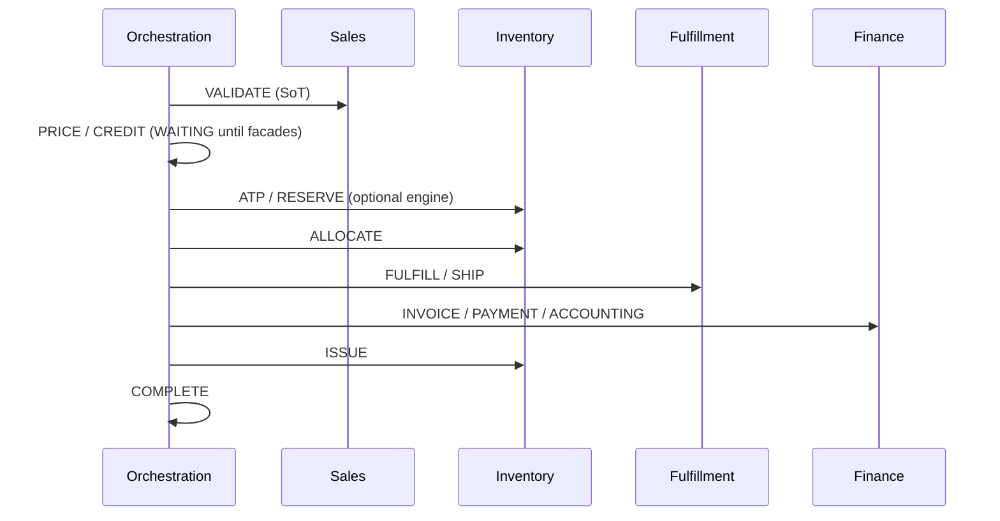
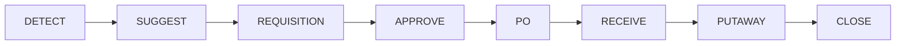

# ERP Sagas

Step definitions live in `src/modules/orchestration/domain/saga.definitions.ts`. Engine helpers: `assertSagaStepTransition`, `nextStep`, `isTerminal`, `buildCompensationPlan`.

## Sales order

Steps: `VALIDATE → PRICE → CREDIT → ATP → RESERVE → ALLOCATE → FULFILL → SHIP → INVOICE → PAYMENT → ISSUE → ACCOUNTING → COMPLETE`

Compensatable: RESERVE, ALLOCATE, FULFILL, SHIP, INVOICE, PAYMENT, ISSUE, ACCOUNTING.

## Purchase order

## Fulfillment

## Return

## Payment

## Replenishment

## Operating the saga

1. `POST /orchestration/sagas` — start (creates steps + business process).
2. `POST /orchestration/sagas/:id/advance` — record `SUCCEEDED` | `FAILED` | `WAITING` | `SKIPPED`.
3. `POST /orchestration/sagas/:id/retry` — from FAILED / WAITING / MANUAL_REVIEW.
4. `POST /orchestration/sagas/:id/compensate` — reverse compensatable completed steps (records COMPENSATED; inventory release via orchestrator when engine present).

`SalesOrderSagaOrchestrator.startForOrder` auto-advances VALIDATE → PRICE(WAITING). Use `tryReserve` when at ATP.
